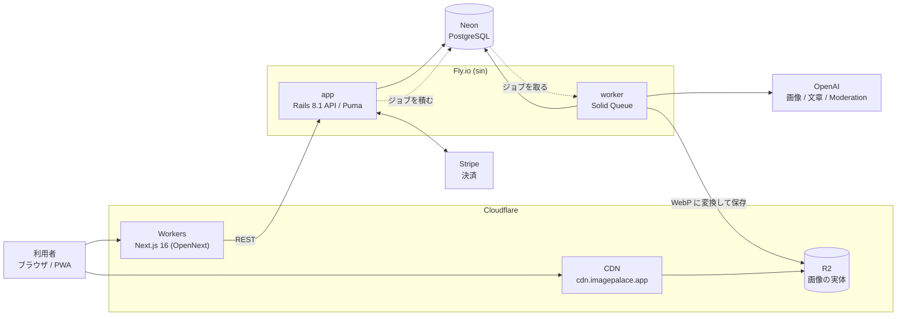

  

  <a href="https://imagepalace.app">imagepalace.app</a>

# ImagePalace — 公開版（抜粋）

**言葉をイメージに変えて、記憶の宮殿をつくる。**

言葉を AI がイメージ画像に変換し、カードとして集めて活用できる学習サービスです。
テキストでは覚えにくい知識を、必要な瞬間に思い出せる形に変えます。

| | |
|---|---|
| アプリ（α版・稼働中） | **https://imagepalace.app** |
| 稼働構成 | Fly.io（Rails API / Solid Queue）+ Cloudflare Workers（Next.js） |
| 開発 | 個人開発。2026-04 にα版リリース、本リリース準備中 |

> **このリポジトリは抜粋です。** 本体（動くアプリ）は非公開で開発しています。
> ここには、**設計の考え方**と、**説明の役に立つコード**だけを置いています。
> `bundle install` しても動きません。
> 読む順番は [docs/code-tour.md](docs/code-tour.md) にあります。

---

## 何のためのアプリか

テキスト中心の学習が合わない人（ビジュアルシンカー）に向けて作りました。
画像を作って終わりにせず、**作ったイメージを学習資産として蓄積し、組み替えて使えます。**

- 言葉や概念から、イメージ付きのカードを作る
- 意味・説明も自動生成し、Wikipedia の記述と突き合わせて補える
- カードは、まとまり・関係図・空間マップなど、目的に応じた構造で整理できる
- 同じカードを複数の構造に置ける。一度作った知識を、文脈ごとに組み替えて使える
- 眺めるだけでなく、クイズや反復練習で「思い出す」ところまで扱える

多くのノートアプリが記録・整理を中心とするのに対し、ImagePalace では
「思い出すためのイメージ」を体験の中心に置いています。

## 技術構成

- **言語**: Ruby 3.3 / TypeScript 5 / SQL
- **フレームワーク**: Rails 8.1（API モード） / Next.js 16（App Router） / React 19 / Tailwind CSS v4
- **DB・ストレージ**: PostgreSQL（Neon） / Cloudflare R2 + CDN / Active Storage
- **インフラ**: Fly.io（app と worker の2プロセス） / Cloudflare Workers（OpenNext 経由） / Docker / GitHub Actions
- **非同期処理**: Solid Queue（キューは PostgreSQL。Redis を持たない）
- **外部 API**: OpenAI（画像生成・文章生成・Moderation） / fal.ai（FLUX・代替プロバイダ） / Stripe / Wikipedia / Sentry
- **認証**: Devise + devise_token_auth / Google OAuth / Sign in with Apple / TOTP / WebAuthn・Passkey
- **品質**: RSpec / Vitest / RuboCop / ESLint / Brakeman / bundler-audit / Rack::Attack
- **画像処理**: libvips（WebP 変換・サムネ・LQIP）

キューを PostgreSQL に置いているため、Redis を持たずに非同期処理ができます（Solid Queue）。
生成は worker が担い、Web を止めません。アプリを DB と同じリージョンに置いているのは、
**往復の本数がそのまま待ち時間になっていた**ためです（70.2ms が 2.4ms になりました）。

## 規模

| | |
|---|---|
| コミット | 1,114（main） |
| issue / PR | 1,309 |
| バックエンド | Ruby 48,631 行 / 394 ファイル |
| テスト（バックエンド） | RSpec 5,015 例 / 395 ファイル・56,600 行 |
| フロントエンド | TypeScript 116,916 行 / 749 ファイル |
| テーブル | 96 |

## 設計の要

`shared_medias.normalized_prompt` の UNIQUE 制約が中核です。
同じ正規化プロンプトでは画像を重複生成せず、生成済みの画像を共有して再利用します。
画像生成 API の重複コストを抑えるための設計で、その代わりに
「同じ見出し語で複数の案を並べて選ぶ」ことはできません。

ただし **実測した共有率は 0.9%**（344回中3回）でした。利用者が少ないうちは重なりません。
数字が出たので「キャッシュが効かなくなる」を理由に機能を諦めるのは止めました
（[engineering-notes](docs/engineering-notes.md)）。

## 当初の想定から変えたこと

着手前の計画から、実際に動かして変えた判断です。

| 項目 | 当初の想定 | 実際の採用 | 変更理由 |
|-----|----------|----------|--------|
| ジョブキュー | Redis | Solid Queue | Rails 8 標準で PostgreSQL をキューに使える。**運用対象を1つ減らせた** |
| バックエンドのホスト | Render | Fly.io | リージョンを選べるため。DB（Neon）の隣へ寄せて **DB往復 70.2ms が 2.4ms**（実測） |
| ストレージ | AWS S3 | Cloudflare R2 | S3 互換のまま転送（egress）無料。画像配信が主用途なので差が大きい |

## このリポジトリの読み方

| | |
|---|---|
| [docs/code-tour.md](docs/code-tour.md) | **ここから。** 抜粋した1ファイルずつの読みどころ |
| [docs/architecture.md](docs/architecture.md) | 構成と、1枚の画像ができるまでの流れ |
| [docs/engineering-notes.md](docs/engineering-notes.md) | 実際に起きた問題と、どう直したか（測った数字つき） |
| [docs/decisions/](docs/decisions/) | 意思決定ログ（決めた時点で書いたもの） |
| [docs/development.md](docs/development.md) | 進め方（issue / PR / レビュー / テスト / CI） |

## 残っている課題（分かっているもの）

- 認証トークンを localStorage に保持しており、CSP に `'unsafe-inline'` が残っている
  （判断の経緯は [csp.ts](frontend/src/lib/security/csp.ts) に書いてあります）
- Rack::Attack のカウンタがプロセスローカル。単一インスタンス構成では整合するが、
  スケールアウト時は差し替えが必要
- 同じカードへの同時操作を1本に絞る形（行ロック → 読み直し）を、残り3か所に広げる途中

## 連絡

実装の相談・指摘・この構成についての質問は、
https://imagepalace.app のお問い合わせ（`/support`）か、GitHub の issue でどうぞ。

脆弱性は [SECURITY.md](SECURITY.md) の手順でお願いします。

## ライセンス

[LICENSE](LICENSE) のとおり、**閲覧と引用は自由**です。
再配布・商用利用・派生サービスの公開は許可していません（稼働中のサービスのため）。
